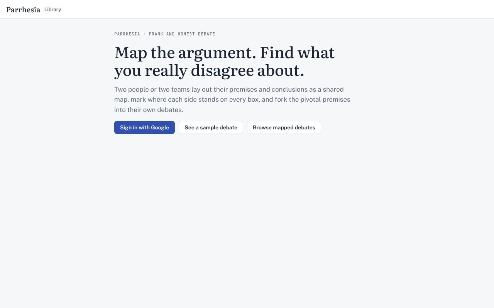

# Parrhesia

<!-- site-summary:start -->
<!-- This section is this project's card on https://mendus59.github.io and is copied there daily.
     Keep it true of what's on main: one plain-text summary line (max 160 characters), then 1-6 short bullets.
     See CLAUDE.md ("Site summary"). -->
Parrhesia: lay out debates as shared argument maps and debate more constructively.

- Debate as a conversation between two people or teams, with the argument tree of reasons and objections built beside it.
- Your opponent accepts or disputes each claim, asks for terms to be defined, and can challenge loaded wording.
- Definitions go back and forth until agreed, with counter-definitions or addenda, so the real disagreement shows.
- Agreed claims, terms and wording carry over to all your debates with the same person, and a change to one flags every conclusion resting on it.
- A claim builder spells out a claim's opposite, converse and contrapositive in plain words, with tips for debating it.
- See your core disagreements at a glance, and spin any of them off into its own sub-debate.
<!-- site-summary:end -->

<!-- site-screenshot: docs/screenshot.jpg -->


Parrhesia (pa-REE-zha, Greek for frank and honest speech) is a web app for laying out debates as argument maps and debating more constructively. Two people or two teams build a shared map of premises, reasons, objections and conclusions, record where each side stands on every box, and fork pivotal premises into sub-debates.

See [docs/SPEC.md](docs/SPEC.md) for the v1 spec and milestones.

## Develop

```sh
npm install
npm run dev          # dev server against the real Firebase project
npm test             # unit tests (Vitest)
npm run test:rules   # security rules and data-layer tests on the Firestore emulator (needs Java 21)
npm run lint
npm run build
```

To develop without touching real data, start the emulators with `npm run emulators` and run the dev server with `VITE_USE_EMULATORS=true npm run dev`.

The Firebase web config in `.env` is public by design; access is controlled by `firestore.rules`.

### Admin access

Importing debates is admin-only. To make an account the admin, sign in once, copy its User UID from Firebase console → Authentication → Users, then in Firestore create a collection `admins` with a document whose ID is that UID (any field, such as `note: "admin"`). Sign out and back in.

### Deploy

The app deploys to GitHub Pages at https://mendus59.github.io/argument_map/ on every push to `main` (`.github/workflows/pages.yml`). One-time setup: in the repo's Settings → Pages, set Source to "GitHub Actions", and in Firebase console → Authentication → Settings → Authorized domains, add `mendus59.github.io`. Security rules still deploy separately (below, or by pasting into the console).

Firebase Hosting also works:

```sh
npx firebase login
npx firebase deploy --only firestore   # rules and indexes
npm run build && npx firebase deploy --only hosting
```

## Stack

React + TypeScript (Vite), React Flow for the map, Firebase (Auth with Google sign-in, Firestore, Realtime Database for presence, Hosting).
